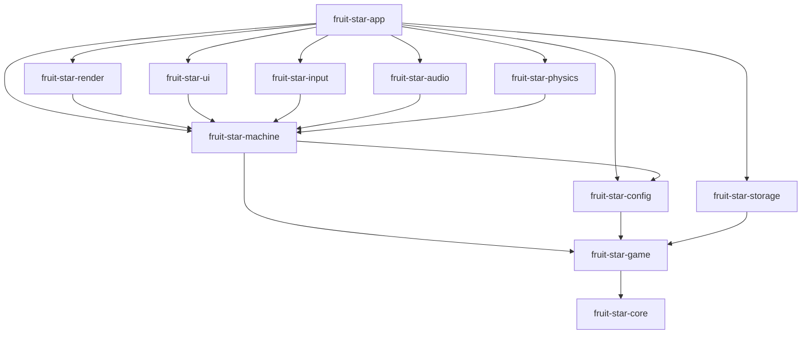

# ARCHITECTURE

FRUIT STAR 3D의 크레이트 구성, 의존 방향, 프레임 처리 순서, 메시지 목록을 설명한다.
규칙 자체는 [GAME_DESIGN.md](GAME_DESIGN.md), 렌더링은 [GRAPHICS_DESIGN.md](GRAPHICS_DESIGN.md)를 본다.

## 1. 계층과 크레이트

| 계층 | 크레이트 | 역할 | Bevy 의존 |
|---|---|---|---|
| Presentation | `fruit-star-render` | 캐비닛·릴 메시, 재질, 조명, 카메라, 논리 상태를 메시·재질에 반영 | 예 |
| | `fruit-star-ui` | 메뉴, HUD, 일시정지·설정, 알림, 디버그 표시, 번역표 | 예 |
| | `fruit-star-input` | 키보드·마우스·트랙패드 입력을 명령 메시지로 변환 | 예 |
| | `fruit-star-audio` | 이벤트에 맞춘 효과음, 공간 음향, 반복음 관리 | 예 |
| | `fruit-star-physics` | 배출된 메달의 낙하·충돌 (bevy_rapier3d) | 예 |
| Application | `fruit-star-machine` | 도메인 컨트롤러를 리소스로 감싸고 명령 전달·시간 진행·이벤트 발행. 표시기·램프·눌림의 논리 상태. 공용 배치 치수 | 예 |
| | `fruit-star-app` | 실행 파일. 설정·저장소 준비, 플러그인 조립, 세션·기록 연동, 창 제어, 자동 실행 옵션 | 예 |
| Domain | `fruit-star-core` | `Symbol`, `Reel`(운동 모델), `CreditLedger`, `RandomSource`, `GameState` | 아니오 |
| | `fruit-star-game` | `MachineProfile`, 추첨, 릴 제어, 평가, 보너스, `GameController`, `GameEvent` | 아니오 |
| Infrastructure | `fruit-star-config` | TOML 로딩·검증, 필수 리소스 목록 | 아니오 |
| | `fruit-star-storage` | SQLite 스키마·마이그레이션, 기록, 통계, 복구 | 아니오 |
| 도구 | `fruit-star-assetgen` | 그림·효과음 생성기. 다른 크레이트에 의존하지 않는다 | 아니오 |

## 2. 의존 방향

각 크레이트 `Cargo.toml`의 내부 의존성은 다음과 같다.

| 크레이트 | 직접 의존하는 내부 크레이트 |
|---|---|
| `core` | 없음 |
| `game` | `core` |
| `config` | `core`, `game` |
| `storage` | `core`, `game` |
| `machine` | `core`, `game`, `config` |
| `render`, `ui` | `core`, `game`, `config`, `machine` |
| `input` | `config`, `machine` |
| `audio` | `game`, `config`, `machine` |
| `physics` | `core`, `config`, `machine` |
| `app` | 위 10개 전부 |
| `assetgen` | 없음 |

아래 그림은 방향만 보이도록 줄인 것이다. 다른 경로로 이미 닿는 간선(예: `render → core`)은 생략했다.
화살표는 "의존한다"를 뜻한다.

- Presentation 크레이트끼리는 서로 의존하지 않는다. 공유할 것은 `fruit-star-machine`의 메시지·컴포넌트·
  `layout` 상수로 주고받는다.
- `fruit-star-core`와 `fruit-star-game`의 외부 의존성은 `thiserror`와 `rand`(game만)뿐이다.
- `fruit-star-storage`를 사용하는 크레이트는 `fruit-star-app`뿐이다.
- 외부 의존성: `machine`·`render`·`input`·`audio`·`ui`·`app`은 `bevy`, `physics`는 `bevy`와 `bevy_rapier3d`,
  `config`는 `serde`·`toml`, `storage`는 `rusqlite`를 쓴다.

## 3. 시작 순서 (`fruit-star-app/src/main.rs`)

1. 명령줄 옵션 해석 (`cli.rs`).
2. 리소스 루트 탐색 (`paths.rs`): 환경 변수 `FRUIT_STAR_ROOT` → 앱 번들 `Contents/Resources` →
   실행 파일 위치에서 위로 올라가며 `assets/`와 `config/`가 함께 있는 디렉터리 → 현재 디렉터리.
3. `ConfigSet::load(config/, Recovery::UseDefaults)`: 없는 파일이나 잘못된 파일은 기본값으로 대체하고 경고를 남긴다.
4. 저장소 열기와 복구 (`persistence::open_store`). 열지 못하면 메모리 저장소로 대체한다.
5. 저장된 사용자 설정을 설정 파일 값 위에 덮어쓴다 (`apply_saved_settings`).
6. `MachineConfig::to_profile()`로 도메인 프로필을 만들고 `GameController`를 생성한다.
7. `DefaultPlugins`(창, 에셋 경로 지정)와 아래 플러그인을 등록한다:
   `MachinePlugin`, `RenderPlugin`, `InputPlugin`, `AudioPlugin`, `PhysicsPlugin`, `UiPlugin`,
   `PersistencePlugin`, `WindowControlPlugin`, `AutomationPlugin`.

## 4. 상태

| 종류 | 정의 위치 | 값 |
|---|---|---|
| 화면 전환 (`AppState`, Bevy `States`) | `machine/state.rs` | `Loading` → `MainMenu` ⇄ `InGame`, 실패 시 `Failed` |
| 일시정지 (`Paused` 리소스) | `machine/state.rs` | `InGame`에서만 의미가 있다. 가상 시간(`Time<Virtual>`)을 멈춘다 |
| 보기 방식 (`ViewMode` 리소스) | `machine/state.rs` | `Play`, `Mechanical`, `Gallery` |
| 게임 진행 단계 (`Phase`) | `game/controller.rs` | `Ready`, `Spinning`, `Stopping`, `Evaluating`, `Result` |
| 릴 상태 (`ReelState`) | `core/reel.rs` | `Idle`, `Accelerating`, `Spinning`, `Decelerating`, `Settling`, `Stopped` |
| 전체 상태 (`GameState`) | `core/game_state.rs` | 계획서의 11개 값. `overall_state()`가 위 상태들을 합쳐 디버그 표시에 쓴다 |

`GameState::MachineSelect`는 열거형에만 있고 어디에서도 만들어지지 않는다.

## 5. 프레임 처리 순서

`MachinePlugin`이 `Update` 스케줄에 `MachineSet::{Input, Simulate, React, Present}`를 이 순서로 연결한다.

| 순서 | 집합 | 시스템 (크레이트) |
|---|---|---|
| 1 | `Input` | `track_focus`, `keyboard_input`, `pointer_camera` (input), `auto_play` (app, `--auto-play`일 때만 동작) |
| 1.5 | `Input` 뒤, `Simulate` 앞 | `handle_app_commands`, `apply_pause` (app/window.rs) |
| 2 | `Simulate` | `apply_commands` → `tick_machine` (machine) |
| 3 | `React` | `track_payout`, `update_display_values`, `update_segments`, `update_lamp_mode`, `update_lamps`, `trigger_pressables`, `animate_pressables` (machine) / `handle_session_commands`, `record_events`, `save_settings` (app/persistence.rs) |
| 4 | `Present` | `sync_reels`, `apply_press_motion`, `apply_segments`, `apply_lamps`, `apply_view_mode`, 메달 연출, 카메라 (render) / 효과음 시스템 (audio) / 화면 갱신 (ui) |

집합 밖에서 도는 것:

- 부품 클릭은 Bevy picking 옵저버(`press_part`, `release_pointer`)가 처리해 `MachineCommand`를 쓴다.
- 메달 물리: Rapier는 고정 스케줄(120 Hz, substep 2)에서 돌고, `spawn_medals`·`report_collisions`·
  `contain_medals`는 `Update`에서 `InGame`일 때 실행된다. `MachineSet`에 속하지 않는다.
- `limit_frame_rate`, `close_on_exit`는 `Last` 스케줄에서 실행된다.
- 화면 전환 훅: `OnEnter(InGame)`에서 `power_on`·`start_ambient`, `OnExit(InGame)`에서 `power_off`·
  `stop_loops`·`clear_medals`·`end_session`.

`apply_commands`는 일시정지 중이거나 `InGame`이 아닐 때 들어온 명령을 그 자리에서 버린다.
`tick_machine`과 `React`의 machine 시스템은 `InGame`이고 일시정지가 아닐 때만 실행된다.

## 6. 메시지와 이벤트

### 도메인 이벤트 (`fruit_star_game::GameEvent`)

`GameController`가 내부 버퍼에 쌓고, `tick_machine`·`power_on`·`power_off`가 `MachineEvent(GameEvent)` 메시지로 내보낸다.

| 이벤트 | 발생 시점 | 구독 |
|---|---|---|
| `PowerOn` / `PowerOff` | `InGame` 진입 / 이탈 | (효과음 `power_on`은 `OnEnter(InGame)`에서 직접 재생) |
| `MedalInserted { entry }` | 메달 투입 성공 | 저장(원장), 음향, 투입 연출 |
| `BetPressed { amount, replay }` | 베팅 성공 또는 리플레이 자동 베팅 | — |
| `LeverPulled { game_id }` | 게임 시작 | 지급 연출 초기화 |
| `ReelStarted(reel)` | 릴 회전 시작 (게임당 3회) | 음향 |
| `StopPressed(reel)` | 정지 입력이 받아들여짐 | — |
| `ReelStopped { reel, index }` | 릴이 목표 위치에 고정됨 | 음향 |
| `GameCompleted(Box<GameOutcome>)` | 평가·정산 완료 (게임당 1회) | 저장, 음향 |
| `MedalDispensed(count)` | 지급이 0보다 클 때 | 지급 연출 |
| `BonusStarted(kind)` / `BonusCompleted { kind, paid, games }` | 보너스 시작 / 종료 | 음향, 램프 연출 |
| `ChanceLampChanged(bool)` | STAR CHANCE 상태 변화 (계획서에 없는 추가 이벤트) | 음향 |

### Bevy 메시지 (`fruit-star-machine/src/messages.rs`)

| 메시지 | 보내는 쪽 | 받는 쪽 | 내용 |
|---|---|---|---|
| `MachineCommand` | input, 자동 플레이 | machine | `InsertMedal`, `Bet`, `Lever`, `Stop(reel)` |
| `MachineEvent` | machine | render, audio, app(저장), machine(램프·지급) | 도메인 이벤트 |
| `AppCommand` | input, 자동 실행 | app(window), render(camera), ui | `CycleCamera`, `ToggleFullscreen`, `ToggleMute`, `TogglePause`, `OpenMenu`, `ToggleDebug` |
| `PartPressed { part, accepted }` | machine | machine(눌림 애니메이션), audio | 입력이 거부되어도 발생한다 |
| `MedalPaidOut { remaining }` | machine | physics, audio | 메달 한 장 배출 |
| `CameraControl { orbit, zoom }` | input | render(camera) | 드래그·스크롤·핀치 |
| `SessionCommand` | ui, 자동 실행 | app(persistence) | `Start { mode, view }`, `End`, `ResetHistory`, `Quit` |
| `Notice { key }` | app | ui | 번역 키로 전달하는 짧은 알림 |
| `MedalCollision { position, strength }` | physics | audio | 충돌음용 |
| `UiClick` | ui | audio | 선택음용 |

공유 리소스: `Machine`(= `GameController`), `Settings`(설정과 리소스 루트), `DisplayValues`, `PayoutCounter`,
`LampMode`, `StatsSnapshot`, `DebugLevel`, `FailureMessage`.

## 7. 저장 연동 (`fruit-star-app/src/persistence.rs`)

- `Persistence` 리소스가 `Store`를 `Mutex`로 감싼다. 현재 세션 ID를 함께 가진다.
- `SessionCommand::Start`: 모드에 맞는 새 `GameController`를 만들어 `Machine`을 교체하고,
  기종 등록(`upsert_machine`) 후 세션을 시작한다. Classic은 저장된 보유 메달로, Free Play와 Practice는 0에서 시작한다.
- `record_events`: `MedalInserted`는 `Store::record_credit`, `GameCompleted`는 `Store::record_game`으로 기록한다.
  `record_game`은 게임 결과, 릴별 결과, 그 게임의 베팅·지급 원장 항목, Classic 보유 메달, 달성 기록을
  한 트랜잭션에 쓴다. 베팅 원장 항목은 게임이 끝날 때 결과와 함께 기록되므로 끝나지 않은 게임은 기록에 남지 않는다.
- `save_settings`: `Settings`가 바뀌면 언어, 음량 3종, 음소거, 그래픽 품질, LED 밝기, 점멸 줄이기를
  `user_settings` 테이블에 저장한다.
- `OnExit(InGame)`과 앱 종료 시 세션을 정상 종료로 닫는다. 닫히지 않은 세션은 다음 실행의 `Store::recover`가 정리한다.
- 테이블: `schema_version`, `machine_profiles`, `game_sessions`, `game_history`, `reel_results`,
  `credit_history`, `user_settings`, `achievements` (`storage/schema.rs`). 파일 DB는 WAL, `synchronous=FULL`로 연다.

## 8. 도메인의 독립성과 헤드리스 테스트

- `GameController`는 입력 메서드(`insert_medals`, `press_bet`, `pull_lever`, `press_stop`)와 `tick(dt)`만으로
  구동되고, 일어난 일은 `drain_events()`로 꺼낸다. 창·GPU·시계에 의존하지 않는다.
- 난수는 `RandomSource` 트레이트로 주입한다. 실행 시에는 `SystemRandom`(rand `StdRng`), 테스트에서는
  `SplitMix64`나 미리 정한 값을 돌려주는 구현을 쓴다.
- 메달 원장(`CreditLedger`)은 `GameController` 안에서만 변경된다. ECS 쪽은 `Machine`을 읽기만 하거나 입력 메서드를 호출한다.
- `fruit-star-machine`은 `MinimalPlugins` + `StatesPlugin`만으로 테스트한다 (`machine/tests/plugin.rs`).
  캐비닛 생성(`render/tests/cabinet.rs`)과 메달 물리(`physics/tests/medals.rs`)도 창 없이 검사한다.

## 9. 미구현 / 계획과의 차이

| 계획서 | 실제 |
|---|---|
| Kira 또는 호환 Bevy 오디오 | Bevy 내장 오디오(`bevy_audio`, `wav` 기능)만 사용 |
| 저장을 독립 Plugin으로 구성 | 저장소 크레이트는 Bevy와 무관하고, 플러그인(`PersistencePlugin`)은 `fruit-star-app` 안에 있다 |
| `GameState`의 `MachineSelect` | 값만 정의되어 있고 화면과 전환이 없다 |
| WGSL 셰이더 | 자체 셰이더가 없다. `assets/shaders/`는 비어 있다 |
| Criterion 벤치마크 | `fruit-star-game/benches/rules.rs`에 도메인 벤치마크가 있다. 루트 `benches/`와 `tests/`는 비어 있다 |
| tracing | 직접 의존하지 않는다. 로그는 Bevy의 `info!`/`warn!`/`error!`/`debug!` 매크로로 남긴다 |
